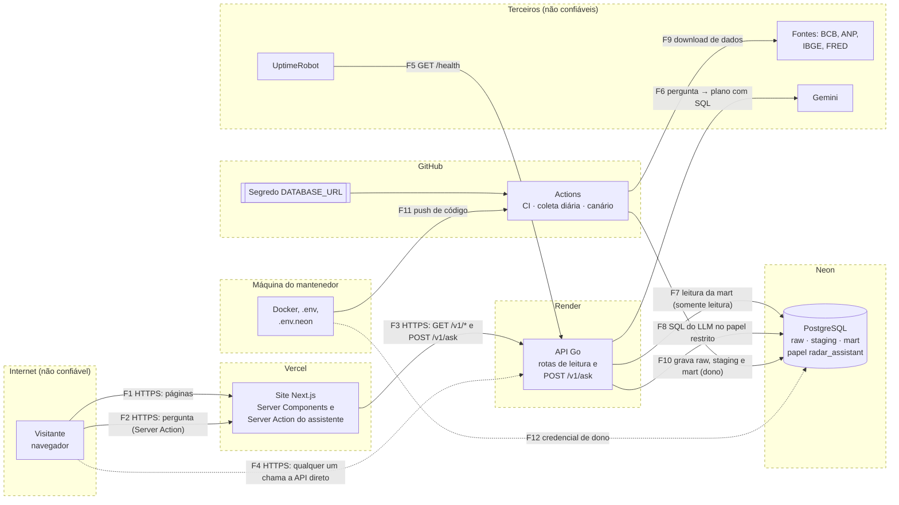

# Modelo de ameaças

Primeira fase da etapa de DevSecOps do Radar Econômico: o que pode ser
atacado, por onde, o que já protege o sistema e o que falta. Cada lacuna
aponta a fase que vai tratá-la. Este documento é o **"antes"**: os achados
estão registrados aqui como foram encontrados, antes de qualquer correção.

- **Data:** 13/11/2026 (código no commit `e06090f`).
- **Escopo:** só o nosso próprio sistema: o código deste repositório, os
  containers locais e o nosso deploy (Vercel, Render, Neon, GitHub Actions).
  Nenhum teste é feito contra sistemas de terceiros.
- **Método:** [STRIDE](#4-análise-stride) aplicado a cada componente e a
  cada fronteira de confiança. O risco combina impacto e probabilidade, numa
  escala de três níveis: **alto**, **médio** e **baixo**.

## 1. Ativos

O que vale proteger, em ordem de importância:

| ID | Ativo | Por que importa |
|---|---|---|
| A1 | Credencial do banco de produção (`DATABASE_URL`, usuário dono `neondb_owner`) | Quem a tem lê, altera e apaga tudo no Neon |
| A2 | Integridade dos dados publicados (schema `mart`) | O site mostra esses números como corretos |
| A3 | Chave da API do Gemini (`GEMINI_API_KEY`) | Gasta a cota grátis; atrelada à conta Google do mantenedor |
| A4 | Disponibilidade do site, da API e da cota diária do assistente | Planos grátis têm limites que podem ser esgotados |
| A5 | Código e workflows do repositório | Quem altera um workflow ganha os segredos do GitHub Actions |
| A6 | Contas do mantenedor (GitHub, Vercel, Render, Neon, Google, UptimeRobot) | Dão controle sobre todos os itens acima |
| A7 | Dados de uso: perguntas feitas ao assistente | Um visitante pode escrever algo pessoal numa pergunta |

Os dados em si (preços, indicadores) são **públicos**: o risco não é que
vazem, e sim que sejam adulterados ou que o sistema fique fora do ar.

## 2. Componentes, atores e fluxos

| Componente | Onde roda | Confiança |
|---|---|---|
| Navegador do visitante | Internet | Não confiável: qualquer pessoa, sem login |
| Site (Next.js: páginas e Server Action do assistente) | Vercel | Nosso |
| API (Go: rotas de leitura e `POST /v1/ask`) | Render | Nosso, exposta na internet |
| Banco PostgreSQL (`raw`, `staging`, `mart`, papel `radar_assistant`) | Neon | Nosso |
| Coletor (Go) e pipeline (Python) | GitHub Actions (coleta diária, canário) e máquina local | Nosso |
| Repositório e segredos do Actions | GitHub | Nosso |
| Fontes de dados: BCB, ANP, IBGE, FRED | Terceiros | Não confiáveis: o conteúdo pode mudar ou vir adulterado |
| Gemini (escreve o SQL do assistente) | Google | Não confiável: a saída pode ser influenciada pela pergunta |
| UptimeRobot (mantém a API acordada) | Terceiro | Só chama `GET /health` |
| Máquina de desenvolvimento (`.env`, `.env.neon`, Docker) | PC do mantenedor | Nosso, guarda segredos em arquivos |

### Diagrama de fluxo de dados

As caixas tracejadas são as **fronteiras de confiança**: cada seta que cruza
uma delas leva dados de um lado em que confiamos para outro em que não
confiamos, ou o contrário.

### Fronteiras de confiança

| ID | Fronteira | O que cruza | Por que é sensível |
|---|---|---|---|
| FC1 | Internet → site | F1, F2 | Entrada de qualquer pessoa, inclusive o texto livre do assistente |
| FC2 | Internet → API | F4, F5 | A API é pública: dá para chamá-la sem passar pelo site |
| FC3 | API → Gemini → API | F6 | A resposta do modelo (o SQL) é entrada não confiável |
| FC4 | API → banco | F7, F8 | O SQL escrito pelo modelo roda no banco de produção |
| FC5 | Fontes → coletor → banco | F9, F10 | Arquivos de terceiros entram no banco |
| FC6 | GitHub Actions → banco | F10 | O Actions tem a credencial de dono do banco |
| FC7 | Máquina do mantenedor → repositório e banco | F11, F12 | Segredos em arquivos locais; o push dispara deploys |

## 3. Controles que já existem

Antes de listar as lacunas, o que o sistema já faz bem (conferido no código):

| Controle | Onde | Contra o quê |
|---|---|---|
| Conexão da API com `default_transaction_read_only=on` | `api/internal/postgres` | Escrita acidental pela API |
| Assistente em quatro camadas: prompt restrito, `CheckSQL` (um único `SELECT`/`WITH`, sem comentários), papel `radar_assistant` (só lê tabelas da mart listadas) e transação somente leitura com `statement_timeout` de 3 s e até 500 linhas | `api/internal/assistant`, migration 000008 | SQL malicioso escrito pelo LLM |
| Erros 500 nunca devolvem a mensagem interna; o detalhe fica no log | `api/internal/httpapi` | Vazamento de detalhes internos |
| Corpo do `POST /v1/ask` limitado a 4 KB, sem campos desconhecidos; pergunta de 3 a 300 caracteres | `api/internal/httpapi/ask.go`, `assistant/service.go` | Entrada abusiva |
| Timeouts no servidor HTTP (`ReadHeaderTimeout`, `ReadTimeout`, `WriteTimeout`, `IdleTimeout`) | `api/main.go` | Conexões lentas presas (Slowloris) |
| Limite diário de perguntas novas e cache de 24 h por pergunta | `assistant/service.go` | Esgotar a cota do Gemini |
| Chave do Gemini só no cabeçalho, nunca na URL; `store: false` | `assistant/gemini.go` | Chave em logs; o Google guardar a conversa |
| Validação dos dados antes de gravar (contrato pandera) e avisos de qualidade | `pipeline/` | Dados adulterados ou quebrados chegando à mart |
| Download com tempo máximo e limite de 100 MB; o coletor confere o formato antes de gravar (JSON, CSV, xlsx) | `collector/internal/fetch`, `collect/` | Respostas enormes ou páginas de erro no `raw` |
| Segredos fora do git: `.env` e `.env.*` no `.gitignore` (só o `.env.example` é versionado) | `.gitignore` | Credencial no repositório |
| Imagens Docker da API e do coletor em distroless `nonroot`; pipeline e web com usuário sem privilégios | `*/Dockerfile` | Processo com poderes de root no container |
| O navegador nunca fala com a API: os dados vêm pelo servidor do Next | `web/` | Exposição direta da API ao navegador (não impede o acesso direto, ver AM-03) |
| HTTPS em todas as pontas (Vercel, Render, Neon com `sslmode=require`) | deploy | Interceptação |

## 4. Análise STRIDE

STRIDE é um checklist com seis tipos de ameaça, um por letra:
**S**poofing (falsificar identidade), **T**ampering (adulterar),
**R**epudiation (negar autoria), **I**nformation disclosure (vazar
informação), **D**enial of service (negar o serviço) e **E**levation of
privilege (ganhar mais poder do que deveria). A coluna "Achado" aponta a
seção 5.

| Elemento | S | T | R | I | D | E |
|---|---|---|---|---|---|---|
| Site (FC1) | Sem login por desenho | XSS no tooltip do assistente (AM-04); sem CSP (AM-05) | — | — | Server Action pública chama a API (AM-03) | — |
| API (FC2) | Qualquer um chama a API direto: aceito, os dados são públicos | — | Logs com `request_id`, retenção curta do Render (AM-11) | `/health/data` mostra nomes de jobs e avisos (AM-11) | Sem limite de requisições (AM-03) | — |
| Gemini (FC3) | — | Pergunta maliciosa influencia o SQL (prompt injection): mitigado pelas camadas | — | Perguntas vão ao Google, que pode usá-las no plano grátis (AM-10) | Cota de 15/min e 500/dia esgotável (AM-03) | — |
| Banco (FC4) | — | Escrita barrada pela transação somente leitura (verificado) | — | Fuga do papel restrito lê `raw`, `staging` e `pipeline_runs` (AM-01) | Consulta pesada: limitada a 3 s (verificado) | **Fuga do papel `radar_assistant` (AM-01)**; credencial de dono para tudo (AM-02) |
| Coletor e fontes (FC5) | Fonte trocada por outra: links de qualquer domínio e `http` aceitos (AM-08) | Arquivo adulterado: o contrato do pipeline barra o que foge do formato | `raw.collection_runs` registra cada coleta | — | Arquivo compactado enorme (zip bomb) (AM-09) | — |
| GitHub Actions (FC6) | — | Action de terceiro adulterada (tags mutáveis) (AM-06) | Histórico de execuções do GitHub | Segredo visível a todos os passos do job (AM-06) | — | Token do workflow com o padrão do repositório (AM-07); credencial de dono (AM-02) |
| Máquina do mantenedor (FC7) | Contas sem 2FA? (AM-13) | Commit com segredo por engano (Fase 2) | Commits identificados | Credencial de dono em texto puro (AM-12) | — | — |

## 5. Achados (o "antes")

| ID | Risco | STRIDE | Achado | Fase que trata |
|---|---|---|---|---|
| AM-01 | **Alto** | E, I | Fuga do papel `radar_assistant` pelo SQL do assistente | 5 |
| AM-02 | **Alto** | E, T, I | Uma credencial de dono do banco para API, coleta, pipeline e máquina local | 2 e 5 |
| AM-03 | Médio | D | Sem limite de requisições; cota do assistente esgotável por uma pessoa | 5 |
| AM-04 | Médio | T | XSS provável no tooltip do gráfico do assistente | 5 e 6 |
| AM-05 | Médio | T, I | Sem cabeçalhos de segurança (CSP e outros) no site e na API | 5 |
| AM-06 | Médio | T, I, E | Segredo do banco exposto a Actions de terceiros referenciadas por tag | 4 e 5 |
| AM-07 | Médio | E | Workflows sem `permissions:` explícito | 4 |
| AM-08 | Baixo | S, T | Coletor da ANP aceita links de qualquer domínio e sem HTTPS | 5 |
| AM-09 | Baixo | D | Sem limite de descompressão nos arquivos de terceiros | 5 |
| AM-10 | Baixo | I | A página do assistente não avisa que o Google pode usar as perguntas | 5 |
| AM-11 | Baixo | I, R | `/health/data` público; logs de curta retenção | 7 (aceitar ou corrigir) |
| AM-12 | Baixo | I | Credencial de dono em texto puro na máquina local (`.env.neon`) | 2 e 5 |
| AM-13 | A verificar | S | 2FA nas contas e proteção da branch `main` | 2 (checklist) |
| AM-14 | Baixo | T | Imagens Docker base por tag, não por digest; sem Dependabot | 4 |

### AM-01: fuga do papel `radar_assistant` (alto, confirmado)

**O que é:** o `CheckSQL` aceita qualquer `SELECT`, e um `SELECT` pode
chamar funções do Postgres. Duas delas, juntas, desfazem a camada do papel:

- `set_config('role', '<dono>', true)` troca o papel **dentro** da consulta.
  O Postgres deixa a sessão voltar ao próprio usuário dela (o dono do banco),
  mesmo depois do `SET LOCAL ROLE radar_assistant`;
- `query_to_xml('<outra consulta>', ...)` executa um texto como consulta já
  com o papel novo, driblando a checagem de permissão, que acontece antes.

**Como foi confirmado:** num Postgres 16 novo e isolado (container
temporário, apagado depois), com o banco criado e migrado por um usuário
**sem** superpoderes, como o `neondb_owner` do Neon, e com as mesmas três
travas do executor (`BEGIN READ ONLY`, `SET LOCAL ROLE radar_assistant`,
`statement_timeout` de 3 s):

| Consulta (um único `SELECT`, como o assistente permite) | Resultado |
|---|---|
| `SELECT count(*) FROM mart.fuel_products` | Funciona (legítima) |
| `SELECT error FROM mart.pipeline_runs` | Barrada: *permission denied* |
| `SELECT set_config('role','<dono>',true), query_to_xml('SELECT error FROM mart.pipeline_runs', ...)` | **Funciona: devolve a mensagem de erro interna** |
| A mesma fuga, tentando um `DELETE` | Barrada pela transação somente leitura |
| `SELECT set_config('statement_timeout','0',true), pg_sleep(5)` | Barrada: o limite de 3 s já está valendo |

**Impacto:** quem conseguir que o modelo escreva essa consulta (escrevendo
a pergunta certa, por prompt injection) lê **todo** o banco: o `raw` (dados
públicos), o `staging` e as mensagens de erro do `pipeline_runs`. **Não**
consegue escrever nem travar o banco. Só não é crítico porque os dados são
públicos e a escrita está bloqueada.

**Causa raiz:** a API conecta como **dono do banco** (AM-02). Com um usuário
próprio, sem acesso além da mart, voltar ao "próprio usuário" não daria
nada. Correções candidatas (Fase 5): usuário só de leitura para a API e
recusar funções perigosas no `CheckSQL` (`set_config`, `query_to_xml`,
`dblink`...), como defesa em profundidade.

### AM-02: uma credencial de dono para tudo (alto)

A API (Render), a coleta e o pipeline (GitHub Actions) e a máquina local
usam a mesma `DATABASE_URL`, do usuário **dono** do banco. Vazar qualquer
uma das cópias dá controle total: ler, alterar e apagar tudo, inclusive o
histórico do `raw`. A API se protege com o modo somente leitura da sessão,
mas esse modo é só um padrão: a própria sessão pode desligá-lo.

**Fase 5:** um usuário por componente, cada um só com o que precisa (o
coletor grava em `raw`; o pipeline lê `raw` e grava `staging` e `mart`; a API
só lê `mart`). **Fase 2:** conferir que a credencial nunca vazou no histórico.

### AM-03: sem limite de requisições (médio)

A API é pública: o `POST /v1/ask` pode ser chamado direto, sem passar pelo
site. O limite diário do assistente (400 perguntas novas) é **global**: uma
única pessoa o esgota para todo mundo, e também a cota do Gemini (15 por
minuto). As rotas de leitura têm cache, mas também não têm limite.
**Fase 5:** limite por cliente (IP) na API e no assistente.

### AM-04: XSS provável no tooltip do assistente (médio, a confirmar)

O tooltip do gráfico do assistente monta HTML com o nome das colunas e os
valores do eixo X (`web/src/components/assistant/assistant-chart-option.ts`),
e o ECharts o insere na página como HTML. Esses textos vêm do SQL escrito
pelo modelo: um apelido de coluna como `""` viraria
código no navegador. A resposta ainda fica no cache por 24 h e é servida a
quem fizer a mesma pergunta. **Fase 5:** escapar o texto e ter uma CSP
(AM-05). **Fase 6:** confirmar com o DAST.

### AM-05: sem cabeçalhos de segurança (médio)

Nem o site nem a API enviam `Content-Security-Policy`,
`X-Content-Type-Options`, `Referrer-Policy` ou proteção contra o site ser
embutido em outro (`frame-ancestors`). **Fase 5.**

### AM-06 e AM-07: o GitHub Actions como porta de entrada (médios)

O `data.yml` põe a `DATABASE_URL` de dono no ambiente do **job inteiro**,
então todos os passos a recebem, inclusive Actions de terceiros
(`astral-sh/setup-uv@v6`, `actions/setup-go@v5`...). Essas referências são
tags, que o autor pode mover para outro código: se uma delas fosse
adulterada, levaria a credencial (AM-06). E nenhum workflow declara
`permissions:`, então o token do GitHub de cada execução usa o padrão do
repositório, que pode incluir escrita (AM-07). **Fase 4:** fixar as Actions
por hash e declarar as permissões mínimas; segredo só no passo que precisa.

### AM-08 e AM-09: arquivos de terceiros (baixos)

O coletor descobre os arquivos mensais lendo a página da ANP, e a expressão
que extrai os links aceita **qualquer domínio** e `http://` (AM-08). Se a
página fosse adulterada, ele baixaria de outro servidor; o conteúdo ainda
passaria pelo contrato do pipeline. As planilhas `.xlsx` são arquivos
compactados: o download tem limite de 100 MB, mas a descompressão não
(AM-09). **Fase 5:** aceitar só `https://` em domínios do governo; limitar o
tamanho descompactado ou aceitar o risco com justificativa.

### AM-10 a AM-14 (baixos e a verificar)

- **AM-10:** no plano grátis, o Google pode usar as perguntas para melhorar
  os produtos dele, e a página do assistente não avisa. As perguntas também
  ficam nos logs da API. Fase 5: aviso na página.
- **AM-11:** o `/health/data` é público e mostra nomes de jobs, horários e
  avisos de qualidade (nunca as mensagens de erro). Os logs do Render (plano
  grátis) têm retenção curta, o que dificulta investigar um abuso. Proposta
  para a Fase 7: aceitar, porque a transparência é intencional e não há dado
  sensível.
- **AM-12:** a credencial de dono fica em texto puro em `.env.neon` na
  máquina local (fora do git, conferido). Fases 2 e 5: gitleaks no
  pre-commit e, com usuários separados, a cópia local deixa de ser de dono.
- **AM-13:** 2FA nas contas do GitHub, Vercel, Render, Neon, Google e
  UptimeRobot, e proteção da branch `main`: não dá para conferir pelo código.
  Fase 2: checklist para o mantenedor.
- **AM-14:** imagens base por tag (`node:26-alpine`, `python:3.13-slim`) e
  sem atualização automática de dependências. Fase 4: Dependabot, Trivy e
  digest fixo.

## 6. Riscos aceitos por desenho

- **Sem login:** o site é público e só mostra dados públicos.
- **API pública:** chamá-la sem passar pelo site é permitido; o que precisa
  de proteção é o consumo (AM-03), não o acesso.
- **Dados de terceiros:** o sistema depende das fontes oficiais. O canário
  diário e o contrato do pipeline detectam mudanças e dados fora do padrão,
  mas não garantem que a fonte esteja certa.

## 7. Próximas fases

| Fase | Trata |
|---|---|
| 2. Segredos (gitleaks) | AM-02 (histórico), AM-12, AM-13 |
| 3. Análise estática (SAST) | Achados novos no código e nas dependências |
| 4. Dependências e containers | AM-06, AM-07, AM-14 |
| 5. Hardening da aplicação | AM-01, AM-02, AM-03, AM-04, AM-05, AM-08, AM-09, AM-10 |
| 6. Análise dinâmica (DAST) | Confirmar AM-04 e AM-05 de fora para dentro |
| 7. Pipeline e documentação | AM-11 e o relatório do "antes e depois" |
